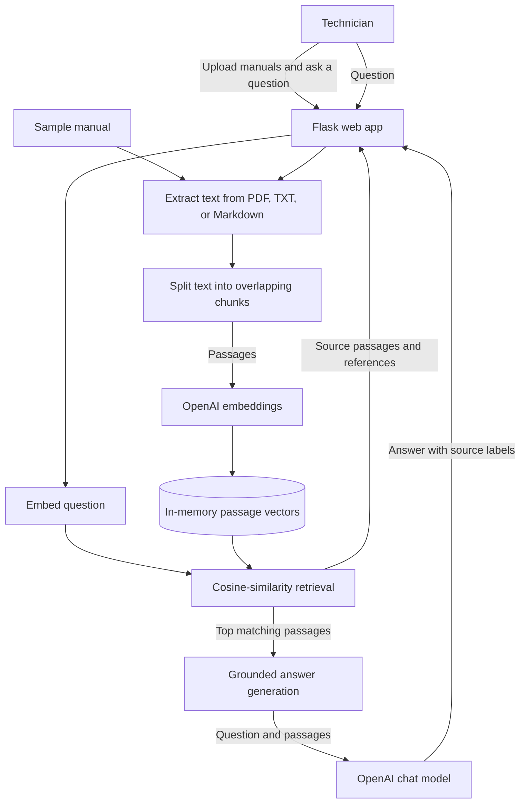
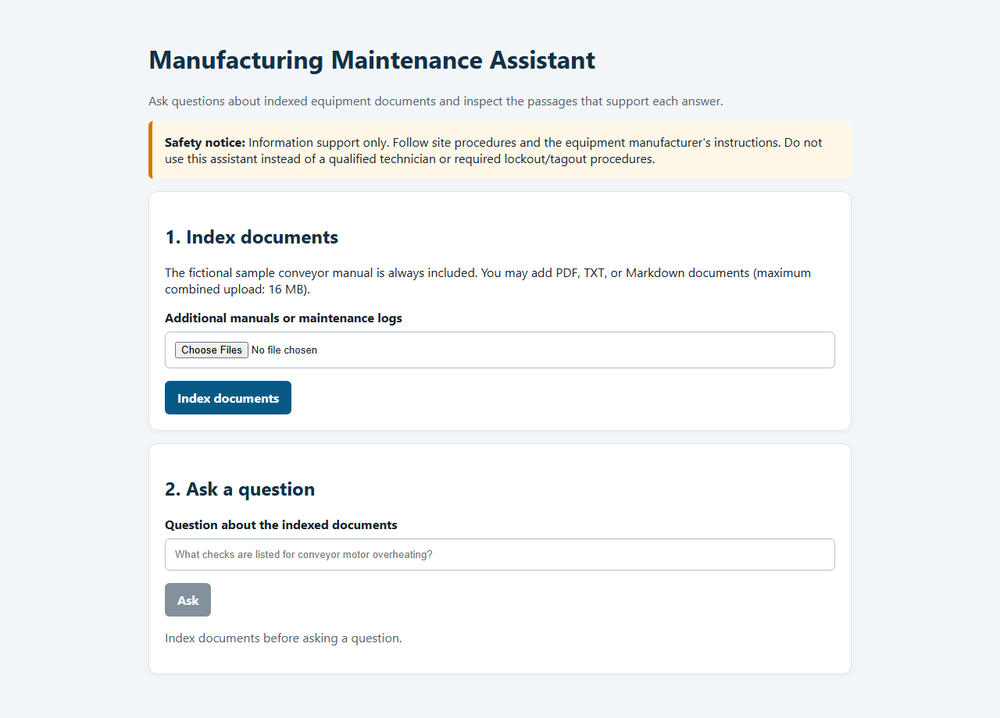

# Manufacturing Maintenance Assistant

A beginner-friendly RAG demo that answers questions from equipment manuals and maintenance notes. It retrieves passages using OpenAI embeddings, generates an answer constrained to those passages, and displays the passages with source references. A fictional conveyor manual is included so the app has sample content immediately.

This is an information-support demo, not a maintenance procedure or a substitute for qualified personnel. Do not use it to operate real equipment.

## Architecture



The app uses a single retrieval-and-generation workflow; it does not run
multiple autonomous agents. Retrieved passages are shown with the answer so
users can inspect its source.

## App preview



The preview is loaded from an immutable GitHub commit URL. Its image file will
be removed from the current branch after publishing, but will remain available
in Git history for this README.

## Run locally

1. Use Python 3.10 or newer. From the project directory, create and activate the virtual environment named `llm`, then install the pinned dependencies:

   ```powershell
   python -m venv llm
   .\llm\Scripts\Activate.ps1
   python -m pip install -r requirements.txt
   ```

2. Edit the included `.env` file and replace the placeholder with your OpenAI API key:

   ```text
   OPENAI_API_KEY=your_openai_api_key_here
   ```

   The app loads `.env` from the project directory. It is ignored by Git; do not commit real credentials. Model names and Flask options can also be configured there.

3. Start the app from the project directory:

   ```powershell
   .\run.bat
   ```

4. Open `http://127.0.0.1:5000`, choose **Index documents**, then ask a question.
   You can optionally add PDF, TXT, or Markdown documents. The app extracts
   text locally and sends text passages to OpenAI for embeddings and answer
   generation.

The demo keeps each session's index in server memory, so restarting the app
clears it. Scanned PDFs require OCR before they can be searched.

Optional environment settings:

- `OPENAI_CHAT_MODEL` (default: `gpt-4.1-mini`)
- `OPENAI_EMBEDDING_MODEL` (default: `text-embedding-3-small`)

## Run tests

```powershell
python -m unittest discover -s tests
```

The tests cover document extraction, chunking, cosine similarity, and retrieval
filtering. Model quality and citation faithfulness should also be evaluated
with a larger set of real test questions before using the pattern in production.
